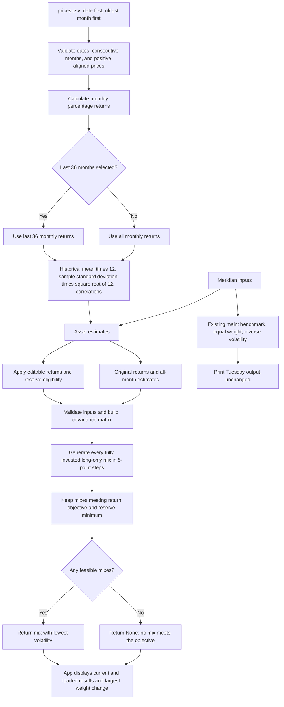

Objective: 6.50% (CPI estimate 2.50% + 4.00%)

Benchmark
  Treasury bills: 0.0%
  Treasury 10-year note: 0.0%
  Investment-grade bond fund: 40.0%
  Global equity index fund: 60.0%
  Expected return: 6.80%
  Volatility: 10.46%
  Reserve-eligible weight: 0.0%
  Meets objective: Yes

Equal weight
  Treasury bills: 25.0%
  Treasury 10-year note: 25.0%
  Investment-grade bond fund: 25.0%
  Global equity index fund: 25.0%
  Expected return: 5.20%
  Volatility: 5.21%
  Reserve-eligible weight: 50.0%
  Meets objective: No

Inverse volatility
  Treasury bills: 84.3%
  Treasury 10-year note: 6.0%
  Investment-grade bond fund: 7.0%
  Global equity index fund: 2.6%
  Expected return: 3.77%
  Volatility: 1.05%
  Reserve-eligible weight: 90.3%
  Meets objective: No
  
# Lab 15 — lowest-risk mix and sensitivity

Built with AI help, a learning demonstration, not investment advice.

## Run locally

From the Lab14 folder:

```powershell
uv run --with streamlit python portfolio.py
uv run --with streamlit python -m streamlit run app.py
```

The requested command `python portfolio.py` initially failed with this exact terminal text:

```text
python : The term 'python' is not recognized as the name of a cmdlet, function, script file, or operable program.
Check the spelling of the name, or if a path was included, verify that the path is correct and try again.
At line:2 char:1
+ python portfolio.py
+ ~~~~~~
    + CategoryInfo          : ObjectNotFound: (python:String) [], CommandNotFoundException
    + FullyQualifiedErrorId : CommandNotFoundException
```

Using the installed uv launcher resolves the missing Python command. Tuesday's original output above is preserved, and an automated comparison confirms it is unchanged.

## Meridian results

Weights follow bills / 10-year note / investment-grade bonds / global equity. Objective: expected return at least 6.5%; reserve-eligible weight at least 3%. Bills and the note count toward reserves. The search tries every fully invested, long-only mix on a 5 percentage point grid.

| Scenario | Weights (%) | Return (%) | Volatility (%) | Reserve weight (%) |
|---|---|---|---|---|
| As loaded | 0 / 20 / 25 / 55 | 6.51 | 9.44 | 20.00 |
| Equity expected return: 8% to 7% | 0 / 10 / 10 / 80 | 6.53 | 12.94 | 10.00 |
| IG–equity correlation: 0.25 to 0.50 in both cells | 0 / 40 / 0 / 60 | 6.52 | 9.73 | 40.00 |

The loaded lowest-risk mix meets the mandate, but its weights do not survive a one percentage point reduction in the equity return estimate: equity rises 25 percentage points and volatility rises from 9.44% to 12.94%. These are modeled estimates, not realized performance. The minimum is over the 5-point grid, not all continuous allocations. The correlation experiment was checked using a temporary input copy; the saved engine retains 0.25.

The app imports the engine on every rerun. After editing portfolio.py, refresh the browser or click **Refresh engine**. The app contains no separate portfolio calculation engine.

## Engine flowchart



## Project 2 — awaiting actual inputs

No prices.csv was found in the accessible workspace. Fund universe, numeric objective, and hard constraint have not been supplied. No personal-universe results or price sources are invented.

Required: five years of monthly adjusted closing prices, date first, oldest first, 3–6 ticker columns. Record each ticker's source and download date here when the data is obtained. The app rejects missing/nonpositive prices, duplicate or nonconsecutive months, and undefined correlations. Last-36 estimation requires at least 37 price rows to calculate 36 returns.

Historical return estimate: arithmetic monthly mean × 12; volatility: sample monthly standard deviation × √12. History is not a forecast. The comparison holds the chosen objective and reserve rule constant; it never lowers the objective to manufacture a feasible mix.

| Your scenario | Weights | Return | Volatility | Reserve weight |
|---|---|---|---|---|
| All months | Pending prices and mandate | — | — | — |
| Last 36 months | Pending prices and mandate | — | — | — |

Largest weight change: pending both feasible results.

Verification: `uv run --with streamlit python verify_lab15.py` checks unchanged Tuesday output, all three known engine results, an infeasible objective, both CSV estimation windows using synthetic data, and Streamlit return controls and displayed sensitivity.
