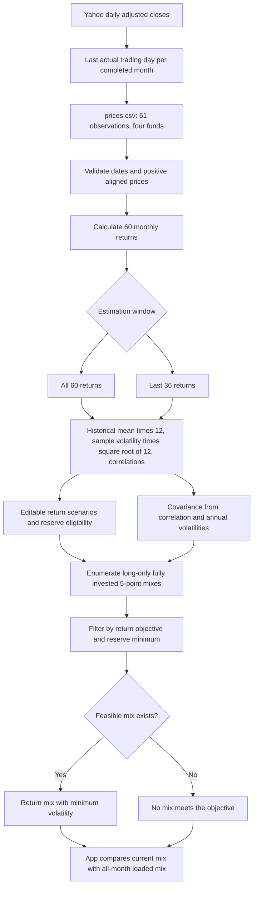

# Lab 15 — Project 2 historical estimates

Built with AI help, a learning demonstration, not investment advice.

Universe: SGOV / VGIT / VCIT / ACWI. Prices are actual Yahoo Finance daily adjusted closes sampled on the last trading day of each completed month. No Tuesday training assumptions are used in these historical estimates.

Downloaded: 2026-10-22T21:27:42.703541+00:00. Price observations: 61, September 2021–September 2026. The first price is the starting anchor, producing exactly 60 monthly returns, October 2021–September 2026. October 2026 is incomplete and excluded.

## Sources

- [SGOV — Yahoo Finance](https://finance.yahoo.com/quote/SGOV/history/), downloaded 2026-10-22.
- [VGIT — Yahoo Finance](https://finance.yahoo.com/quote/VGIT/history/), downloaded 2026-10-22.
- [VCIT — Yahoo Finance](https://finance.yahoo.com/quote/VCIT/history/), downloaded 2026-10-22.
- [ACWI — Yahoo Finance](https://finance.yahoo.com/quote/ACWI/history/), downloaded 2026-10-22.

Raw daily downloads are retained in `raw/`. `data_sources.json` records the provider, field, retrieval timestamp, date boundaries, and yfinance version. Yahoo may revise adjusted prices after subsequent distributions.

## Method

Monthly return = adjusted close / prior adjusted close − 1. Historical expected-return estimate = arithmetic monthly mean × 12 (not CAGR and not a forecast). Annual volatility = sample monthly standard deviation × √12, with ddof=1. Correlation = Pearson correlation of aligned monthly returns. Annual covariance = sample monthly covariance × 12 = correlation × annual volatility_i × annual volatility_j. Covariance is in decimal-return-squared units. No missing months are filled.

## Provisional optimization settings

The 6.5% objective and 3% reserve minimum remain editable defaults from the lab, not confirmed personal mandate terms. Only SGOV counts toward reserves provisionally. VGIT is unchecked because its mandate eligibility is unconfirmed. Neither label is a legal eligibility determination. Searches are long-only, fully invested, on a 5 percentage point grid.

## All 60 monthly returns

| Asset | Historical expected return (%) | Annual volatility (%) |
| --- | --- | --- |
| SGOV | 3.7151 | 0.4989 |
| VGIT | -0.2948 | 5.4139 |
| VCIT | 0.6425 | 7.7752 |
| ACWI | 12.1413 | 14.8856 |

### Correlation

| Asset | SGOV | VGIT | VCIT | ACWI |
| --- | --- | --- | --- | --- |
| SGOV | 1.000000 | 0.254725 | 0.275257 | 0.188378 |
| VGIT | 0.254725 | 1.000000 | 0.939210 | 0.585739 |
| VCIT | 0.275257 | 0.939210 | 1.000000 | 0.767697 |
| ACWI | 0.188378 | 0.585739 | 0.767697 | 1.000000 |

### Annualized covariance

| Asset | SGOV | VGIT | VCIT | ACWI |
| --- | --- | --- | --- | --- |
| SGOV | 0.00002489 | 0.00006880 | 0.00010677 | 0.00013989 |
| VGIT | 0.00006880 | 0.00293100 | 0.00395348 | 0.00472040 |
| VCIT | 0.00010677 | 0.00395348 | 0.00604530 | 0.00888518 |
| ACWI | 0.00013989 | 0.00472040 | 0.00888518 | 0.02215824 |

Lowest-risk mix (SGOV / VGIT / VCIT / ACWI): **65% / 0% / 0% / 35%**. Historical return estimate **6.66%**, volatility **5.28%**, reserve weight **65.00%**.

40% VCIT / 60% ACWI benchmark evaluated using this same historical window: return 7.54%, volatility 11.49%. It has 0% reserve weight and fails the provisional reserve rule.

## Last 36 monthly returns (October 2023–September 2026)

| Asset | Historical expected return (%) | Annual volatility (%) |
| --- | --- | --- |
| SGOV | 4.4400 | 0.2128 |
| VGIT | 3.5200 | 4.6486 |
| VCIT | 5.7689 | 6.2058 |
| ACWI | 20.5040 | 11.5327 |

### Correlation

| Asset | SGOV | VGIT | VCIT | ACWI |
| --- | --- | --- | --- | --- |
| SGOV | 1.000000 | 0.207393 | 0.253190 | 0.127335 |
| VGIT | 0.207393 | 1.000000 | 0.934852 | 0.484699 |
| VCIT | 0.253190 | 0.934852 | 1.000000 | 0.659089 |
| ACWI | 0.127335 | 0.484699 | 0.659089 | 1.000000 |

### Annualized covariance

| Asset | SGOV | VGIT | VCIT | ACWI |
| --- | --- | --- | --- | --- |
| SGOV | 0.00000453 | 0.00002052 | 0.00003344 | 0.00003125 |
| VGIT | 0.00002052 | 0.00216099 | 0.00269692 | 0.00259854 |
| VCIT | 0.00003344 | 0.00269692 | 0.00385123 | 0.00471710 |
| ACWI | 0.00003125 | 0.00259854 | 0.00471710 | 0.01330032 |

Lowest-risk mix (SGOV / VGIT / VCIT / ACWI): **85% / 0% / 0% / 15%**. Historical return estimate **6.85%**, volatility **1.76%**, reserve weight **85.00%**.

40% VCIT / 60% ACWI benchmark evaluated using this same historical window: return 14.61%, volatility 8.76%. It has 0% reserve weight and fails the provisional reserve rule.

Largest weight change between all months and last 36: **20.00 percentage points**.

## Run

From this folder:

```powershell
uv run --with streamlit python -m streamlit run app.py
```

The app defaults to the local actual-price dataset. Meridian is separately labeled training data. Uploading a file overrides the selected dataset. The last-36 switch recalculates from prices; edited return boxes are scenario assumptions.

Recalculate saved estimates: `uv run --with streamlit python analyze_prices.py`. Refresh actual prices from Yahoo: `uv run --with yfinance python download_prices.py`, then rerun analysis. The download script fixes this assignment window for reproducibility. `portfolio.py` still prints the original training outputs when executed directly, as required by the lab.

## Engine flowchart



